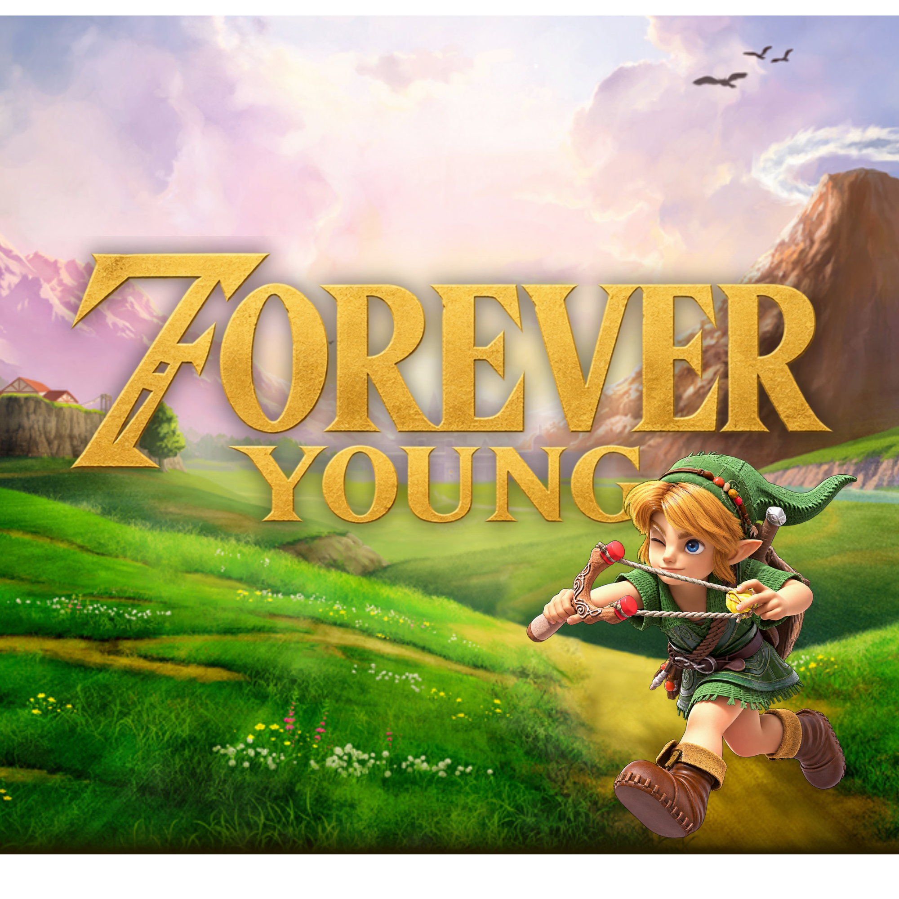

<div align="center">
  
  <h1>Forever Young</h1>
  <p><strong>Play the Adult era as the original Young Link.</strong></p>
  <p><code>0.1.0 Preview</code> · <code>NX2navi 0.10.1</code> · <code>Game 1.1.1</code></p>
  <p><a href="#install">Install</a> · <a href="#tested-in-game">Tested in game</a> · <a href="#known-limitations">Known limitations</a></p>
</div>

Forever Young gives Link his original Young Link body, clothes, face, hair, and voice during Adult gameplay. The mod keeps the Adult gameplay actor in charge of story age, equipment, and abilities, so you can wield the Master Sword and use the Hookshot as Young Link.

## Install

You’ll need a local Windows installation of **NX2navi 0.10.1** with **game update 1.1.1**, plus Python 3.10 or newer. Download this repository with **Code → Download ZIP**, extract it, and open PowerShell in the extracted folder.

```powershell
python -m pip install -r requirements.txt
python build_release.py
```

The builder generates `release/Forever Young` using indexed reads from your local game archive. It reads only the files it needs.

1. Close NX2navi. Move any older Forever Young folder out of the game’s `mods` directory.
2. Copy the generated **Forever Young** folder into `%LOCALAPPDATA%\Programs\NX2navi\game\mods`.
3. Launch NX2navi and load an Adult save. On a Child save, the appearance change takes effect once the story reaches the Adult era.

To uninstall, close NX2navi and move **Forever Young** out of `game\mods`. The installer writes a removable override folder and does not require save edits.

## Tested in game

| On a disposable Adult save | Result |
| --- | --- |
| Running | Original Young Link model rendered in Adult gameplay. |
| Master Sword and Hylian Shield | Sword and guard inputs worked. Sword actions requested the replaced voice streams. |
| Hookshot | The game logged aim, launch, and chain return. |
| Sun’s Song | The in-game sequence rendered Young Link in close-up. |

## Known limitations

- The Fairy Bow and some other Adult equipment actions still need animation work.
- Story scenes such as the age transition need dedicated tests.
- Changing appearance uses NX2navi’s mod toggle and requires a restart.

When reporting an issue, include your NX2navi and game versions, the scene or equipment involved, and a screenshot if helpful. Please keep personal saves and game files out of issue attachments.

## Credits

RomFS and animation tooling from [Kabosune’s OoT Remake Modding project](https://github.com/Kabosune/oot-remake-modding) is included under its [MIT license](reference/LICENSE). Zelda characters and game assets belong to their respective rights holders. Forever Young is an unofficial fan project. The repository contains source and branding. The mod is built locally from your own installation.
